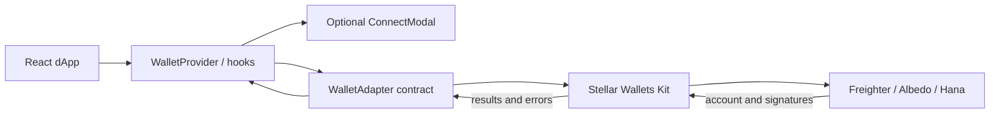

# Stellar Wallet Adapter

[](https://github.com/OlaBakare/stellar-wallet-adapter/actions/workflows/ci.yml)
[](LICENSE)
[](https://www.npmjs.com/package/stellar-wallet-adapter)

A TypeScript and React integration layer for Stellar dApps. It provides one
wallet adapter contract, a React context and hooks, and an optional connection
modal for Freighter, Albedo, and Hana. Wallet discovery, account access, and
signing are delegated to the
[Stellar Wallets Kit](https://stellarwalletskit.dev/); this package focuses on
React state, network passphrases, reconnection, and UI.

## Why this project

Stellar dApps otherwise need to integrate wallet-specific connection APIs and
coordinate asynchronous connection state throughout their React UI. This
library gives applications a consistent, typed interface while retaining the
official wallet kit as the wallet-communication layer. It does not submit
transactions, provide an RPC client, or replace the Stellar Wallets Kit.

## Compatibility

- React and React DOM 18 or newer
- TypeScript 5.x recommended
- Freighter, Albedo, and Hana through Stellar Wallets Kit 2.x
- Networks: Stellar Public Network, Testnet, and Futurenet

Wallet availability depends on the wallet's browser support, installation, and
permissions. Never ask users to share their secret keys; transactions are
reviewed and signed by the selected wallet.

## Install

```sh
npm install stellar-wallet-adapter
```

`react` and `react-dom` are peer dependencies. No API keys, RPC URL, or
environment variables are required by the library: network selection is passed
to the wallet kit as a Stellar network and passphrase.

## Quick start

```tsx
import { StellarWalletAdapter, useWallet } from "stellar-wallet-adapter";

function WalletPanel() {
  const {
    isConnected,
    walletAddress,
    openModal,
    disconnect,
    error,
  } = useWallet();

  if (isConnected) {
    return (
      <section>
        <p>Connected account: {walletAddress}</p>
        <button onClick={() => void disconnect()}>Disconnect</button>
        {error && <p role="alert">{error}</p>}
      </section>
    );
  }

  return (
    <section>
      <button onClick={openModal}>Connect a Stellar wallet</button>
      {error && <p role="alert">{error}</p>}
    </section>
  );
}

export default function App() {
  return (
    <StellarWalletAdapter defaultNetwork="TESTNET" autoConnect>
      <WalletPanel />
    </StellarWalletAdapter>
  );
}
```

The convenience component renders the connection modal automatically. For a
custom modal or wallet adapter list, use `WalletProvider` directly:

```tsx
import { WalletProvider, useWallet } from "stellar-wallet-adapter";

function App() {
  const { wallets, connect, error } = useWallet();
  // Render your own wallet selection UI with these values.
  return (
    <div>
      {wallets.map((wallet) => (
        <button key={wallet.id} onClick={() => void connect(wallet.id)}>
          Connect {wallet.name}
        </button>
      ))}
      {error && <p role="alert">{error}</p>}
    </div>
  );
}

export function Root() {
  return <WalletProvider autoConnect={false}><App /></WalletProvider>;
}
```

The connection modal uses Tailwind CSS utility classes. If your application
builds Tailwind styles, include the distributed package in its content scan:

```js
// tailwind.config.js
module.exports = {
  content: [
    "./src/**/*.{js,ts,jsx,tsx}",
    "./node_modules/stellar-wallet-adapter/dist/**/*.{js,mjs}",
  ],
  // Keep the rest of your Tailwind configuration.
};
```

### Local example

The runnable demo uses a single non-secret configuration value. From the
repository root:

```sh
cp example/.env.example example/.env
cd example
npm install
npm run dev
```

Set `VITE_STELLAR_NETWORK` in `example/.env` to `TESTNET` (default), `PUBLIC`,
or `FUTURENET`. The example validates this value and falls back to Testnet if
it is invalid. Vite exposes `VITE_` variables to browser code; do not put
secrets in them.

## API reference

### Components

| Export | Purpose | Important props |
| --- | --- | --- |
| `StellarWalletAdapter` | Provider with the built-in connection modal | `children`, `defaultNetwork?`, `autoConnect?` |
| `WalletProvider` | Context provider for custom connection UI | `children`, `defaultNetwork?`, `autoConnect?`, `wallets?` |
| `ConnectModal` | Accessible wallet-selection dialog | `isOpen`, `onClose`, `wallets`, `onSelectWallet`, `isConnecting`, `connectingWalletId`, `error` |

`defaultNetwork` accepts `"PUBLIC"`, `"TESTNET"`, or `"FUTURENET"` and defaults
to `"TESTNET"`. `autoConnect` defaults to `true`. `WalletProvider` accepts
custom adapters implementing the exported `WalletAdapter` type.

### Hooks

| Export | Return values |
| --- | --- |
| `useWallet()` | `walletAddress`, `isConnected`, `isConnecting`, `activeWallet`, `activeChain`, `error`, `wallets`, `connect`, `disconnect`, `signTransaction`, `signMessage`, `setActiveChain`, `isModalOpen`, `openModal`, `closeModal` |
| `useWalletActions()` | The `useWallet()` values with wrapped `connect` / `disconnect`, plus `actionLoading` and `actionError` |

Both hooks must be called below `WalletProvider` or `StellarWalletAdapter`.
`connect(walletId)`, `disconnect()`, `signTransaction(xdr)`, and
`signMessage(message)` return promises. Connection failures update `error` and
reject the promise. `useWalletActions()` captures connect/disconnect failures
in `actionError`; signing failures reject to the caller.

Example signing with explicit rejection handling:

```tsx
const { isConnected, signTransaction, error } = useWallet();

async function sign(xdr: string) {
  if (!isConnected) return;
  try {
    const signedXdr = await signTransaction(xdr);
    // Submit signedXdr using your application's transaction submission flow.
    return signedXdr;
  } catch (cause) {
    // Present the wallet rejection or signing error in your UI.
    return error ?? (cause instanceof Error ? cause.message : "Signing failed.");
  }
}
```

Signing is delegated to the active wallet. This package does not broadcast
signed XDR or validate transaction contents; applications should construct and
simulate transactions using their own Stellar SDK / RPC workflow.

## Architecture



The provider owns React connection state and persists the selected wallet,
address, and network in browser local storage for reconnection. Adapter modules
are loaded on demand, and the Stellar Wallets Kit handles the wallet-specific
protocols. `signTransaction` receives the passphrase corresponding to the
currently selected network; `signMessage` follows the same network selection.

## Testing and development

```sh
npm ci
npm run check
```

`npm run check` runs TypeScript type checking, ESLint, Vitest, and the package
build. Tests use injected fixture adapters; these mocks are isolated to tests
and are not used as wallet implementations at runtime.

For focused commands:

```sh
npm run typecheck
npm run lint
npm test
npm run coverage
npm run build
```

See [CONTRIBUTING.md](CONTRIBUTING.md) for the contributor workflow and
[docs/ISSUES.md](docs/ISSUES.md) for contributor-ready issue drafts.

## Ecosystem value and Drips alignment

This project supports Stellar application teams by making wallet integration
consistent across common wallets, reducing repeated React connection-state
code, and providing an accessible connection UI. It builds on the ecosystem's
Stellar Wallets Kit instead of duplicating wallet protocols, and it keeps
network selection aligned with Stellar network passphrases.

The repository accepts focused contributions with tests and clear review
criteria. CI runs on pull requests and pushes to `main`; issues in
[docs/ISSUES.md](docs/ISSUES.md) are scoped to be directly actionable.
Participation in a Drips Wave or reward program is subject to that program's
current rules and acceptance process; this repository cannot guarantee points
or funding.

## Governance

- [Code of Conduct](CODE_OF_CONDUCT.md)
- [Contributing guide](CONTRIBUTING.md)
- [Security reporting](#security)
- [MIT License](LICENSE)

### Security

Please do not report vulnerabilities in public issues. Contact the maintainers
through the private vulnerability reporting option on GitHub for this
repository. Include steps to reproduce and affected versions; do not include
wallet secret keys or other credentials.

## License

MIT. See [LICENSE](LICENSE).
